# Screens

What the board can show, one section per screen: what's on it, when it
appears, and what controls it. The first half is the LED panel (128×32, two
chained 64×32 panels); the second is the admin web page. For the order the
panel moves through them on a game day, see the game-flow page on the wiki
and "What it shows" in the [README](README.md#what-it-shows).

**About the pictures.** Every panel image below is generated, not drawn by
hand: `scripts/render-screens.py` pushes each scene of `nhl-scoreboard
--demo` through the real renderer and saves it as round LED dots to
`docs/screens/`. The teams are made up (your favourite plays the home side)
and logos are plain circles in team colours, because the real crests are NHL
artwork and aren't committed. Animated screens are stills: a shootout shows
its settled look, a holiday its fly-by two seconds in, a scrolling table its
top. A test fails when an image goes stale, so after a layout change run:

```bash
python scripts/render-screens.py
```

Screen names in `code` are the `Scene.kind` values in `app.py`.
`_favourite_scene`, `_select_base_scene` and `select_scene()` there decide
which one shows; `ScoreboardApp.draw_scene()` hands it to a `Renderer.draw_*`
method.

- [How a screen gets chosen](#how-a-screen-gets-chosen)
- [Game screens](#game-screens): `game`, `goal`, `goal_detail`, `three_stars`, shootout, `scores`
- [Before a game](#before-a-game): `preview`, `countdown`, `matchup`, `matchup_meetings`
- [Between games](#between-games): `standings`, `conference_leaders`, `division`, `wildcard`, `leaders`, `clock`, `christmas_tree`
- [Setup and status screens](#setup-and-status-screens): `address`, `ap_setup`, `wifi_join`, `connecting`, `no_data`, `no_games`
- [Holiday decorations](#holiday-decorations)
- [Variants](#variants-that-apply-to-most-screens)
- [The admin page](#the-admin-page)

## How a screen gets chosen

Highest priority first:

1. `wifi_join`: while a Wi-Fi join from the setup page is running, and for 15s after.
2. `ap_setup`: while the board has no network and is broadcasting its own setup network.
3. Night-mode blanking, if `dim_brightness = 0`: nothing is drawn at all.
4. Goal override: `goal`, then `goal_detail`, or `three_stars` after a final.
5. Followed teams' live games (the favourite, plus `also_follow`).
6. The favourite's own screen: live, then the held final, then a game today, then the next game from the schedule.
7. With nothing live or upcoming, the **idle rotation**: a list of screens, each for its own number of seconds, set by `[[rotation]]` entries in `scoreboard.toml` or the admin page's Idle rotation card. A screen with nothing to show right now is skipped, never shown blank.
8. With no favourite set, or nothing left in the rotation: every game today, one at a time (or as the `scores` grid if `scores_grid` is on).
9. Otherwise `clock` (`show_clock_when_idle`) or `no_games`.

Before the first successful fetch the board shows `connecting`; if the last
good fetch is over 15 minutes old it shows `no_data`.

## Game screens

### `game`: live, final and pregame

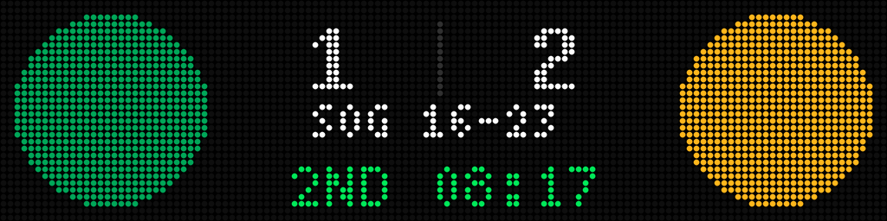

The default view. Away team on the left, home on the right, each with its
logo at the panel edge; a score under each logo's side of the centre column,
and a status band underneath. The score is white; the status colour tells
the state: green while live, amber in intermission, dim once final.

The band shows, in order of precedence: **power play** (`PP 1:23`, in amber)
or **empty net** (`EN`) from the NHL's situation data; otherwise **shots on
goal** (`SOG 16-23`), which is always available. The period and clock sit
below it (`2ND 08:17`, `INT2`, `OT`, `FINAL`, `FINAL/OT`, `FINAL/SO`).

| | |
|---|---|
| 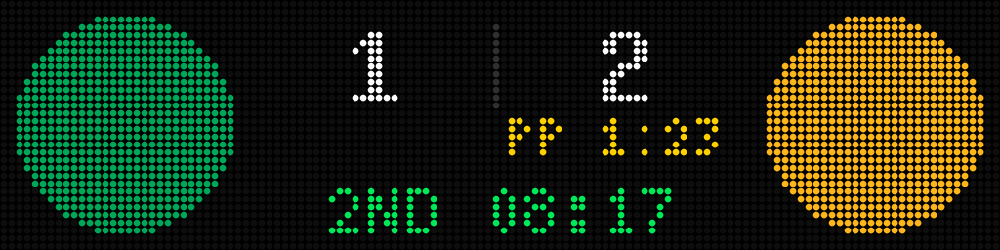 | 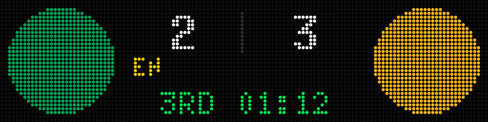 |
| Power play: `PP` and the time left, in amber, on the side of the team with the advantage. | Empty net: the trailing side has pulled its goalie. |
| 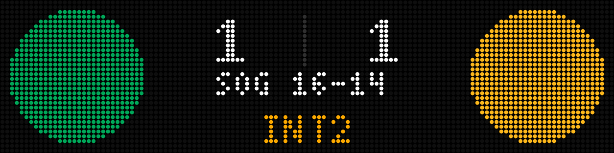 | 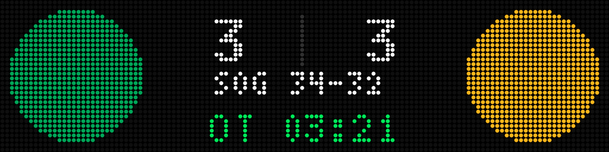 |
| Intermission (`INT2`). | Overtime. |
| 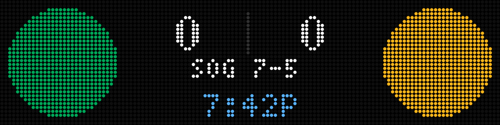 | 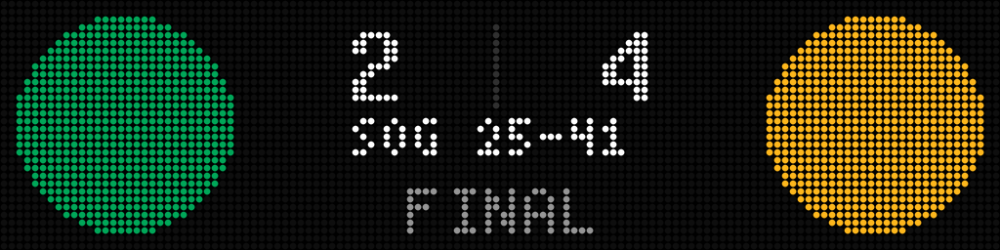 |
| Puck about to drop: the start time in place of the period. | The held final: stays up `final_hold_minutes` after the game *ended*. |

- **Controls:** `show_logos`, `logo_variant`, `final_hold_minutes`.
- **Power-play data** is fetched only for followed teams' live games and the
  game on screen, never during intermission. Shots on goal come free with the
  score feed, so they're shown for every game.
- **No favourite marker** is drawn; #33 removed it deliberately.

### `goal`: the favourite scores

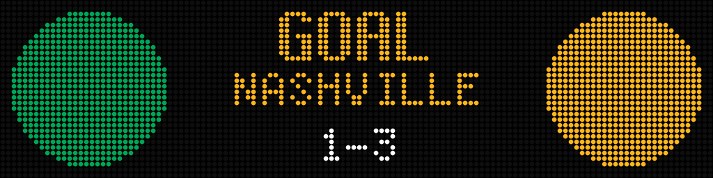

"GOAL" and the scoring team's city name in its colours, the score below in
white, for `goal_flash_seconds`. If the name doesn't fit (a single 64px
panel) it falls back to the abbreviation. The horn plays the moment the goal
is detected, whatever is on screen.

- **Only** the favourite's own goals count in its own game; a followed team
  scoring on the favourite gets no screen. Two followed teams playing each
  other both count. Any live followed game's goal interrupts another's turn.
- It never interrupts a countdown, preview, idle screen or an unfollowed
  game in the all-games rotation.
- A game already 3-1 at startup does not celebrate.

### `goal_detail`: who scored

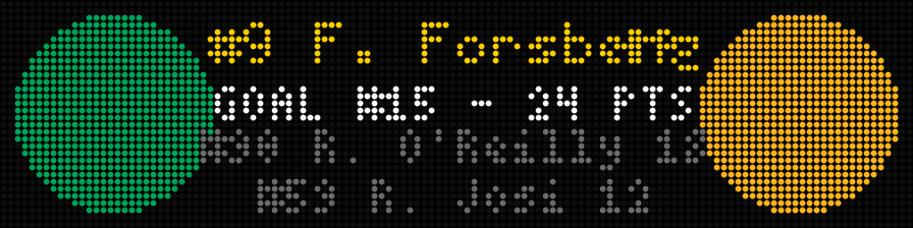

Follows the goal flash for `goal_detail_seconds`: jersey number and name
(`#9 F. Forsberg`), a `PP`/`SH` badge when it wasn't even strength, the
season goal total and points, and up to two assists (or `UNASSISTED`). The
text sits between the logos; a long name can run into a cropped logo on a
single 64px panel, which is accepted rather than truncated (#122).

### `three_stars`: the NHL's three stars

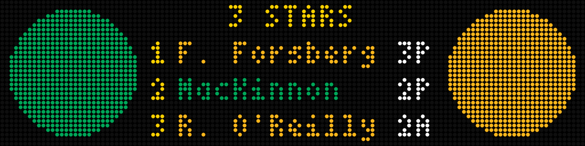

Once, when a game the favourite played goes final: `3 STARS` over one line
per star (rank, name in that player's team colour, one per-game stat: `2G`,
`1A` or `3P`), for `three_stars_seconds`, then the held final takes over.
The stars can come from either team. A game already final at startup doesn't
show it, and a goalie's line has no stat. A name that doesn't fit shortens to
the surname, then truncates.

### Shootout

| | |
|---|---|
| 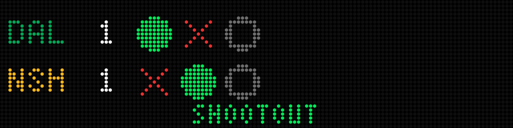 | 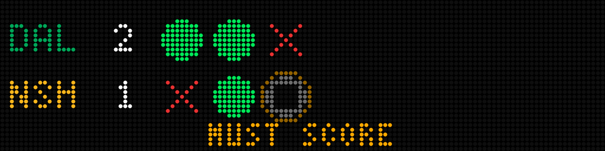 |
| Live: away row over home row, one column per shot. | `MUST SCORE`: that team's next shot is ringed and slowly breathes. |
| 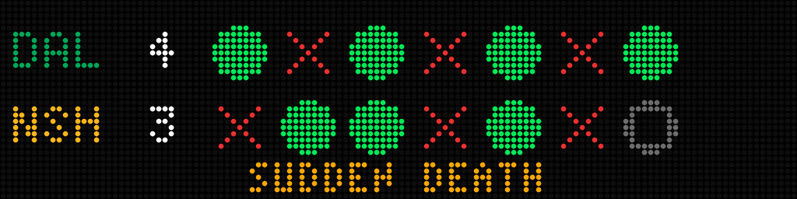 | 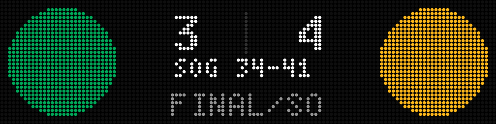 |
| `SUDDEN DEATH`: past three rounds the latest attempts scroll in. | Once the game is over it reverts to the plain game scene, `FINAL/SO`. |

A live game in a shootout (`periodType == "SO"`) replaces `game` with this
grid. Green disc is a goal, red X anything else, a dim ring a shot still to
come; no shooter names. The newest attempt pops in for 1.5s (a goal grows
from a dot and flashes a white ring, a miss draws its X in two strokes, the
scoring team's tally blinks). The label is `SHOOTOUT` when the feed doesn't
look complete or in order. The same game once it ends is a plain `game`
scene labelled `FINAL/SO` (above, and here for a game the favourite didn't play, as the all-games
rotation shows it):

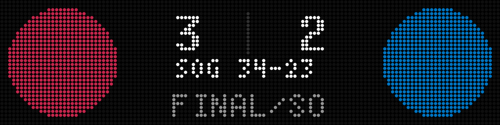

The shootout screen is live-only. The headline score stays tied through a
shootout, so the favourite's win registers as a goal: the horn plays, but no
`goal` or `goal_detail` is drawn over the grid. Three stars still shows.
Polled every `shootout_poll_seconds` (default 5) for followed teams' games
and the game on screen. Not verified against a live sudden-death payload.

### `scores`: several games on one frame

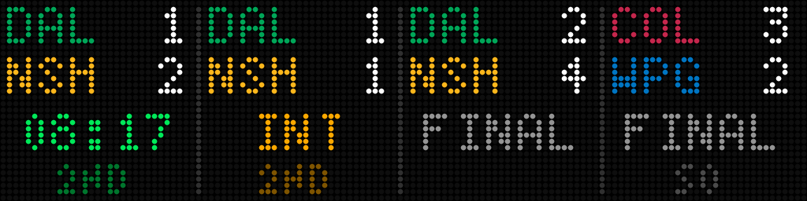

One 32px column per game (four at 128px, two at 64px): away and home
abbreviation in team colour with its score, the status in the state's colour
(live, intermission, final), and the period in tiny text under it. A short
last page is centred. No PP or SOG indicator. It reads only the score feed,
so it fetches nothing extra.

- **Controls:** opt-in two ways. Add `{screen = "scores", seconds = N}` to
  `[[rotation]]` (pages share the seconds evenly; skipped with no games
  today), or turn on `scoreboard.scores_grid` to replace the one-game-at-a-time
  fallback. A single game still gets the full `game` scene.

## Before a game

### `preview`: the next game, hours away

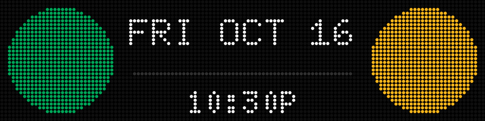

Both logos, a day label (`TONIGHT`, `TOMORROW`, `FRI OCT 16`) above a rule, and
the start time below. Shown when the favourite's next game is further off than
`countdown_hours`. The next game comes from the season schedule, fetched once
an hour. Part of the idle rotation (entry `countdown_preview`).

### `countdown`: puck drop is close

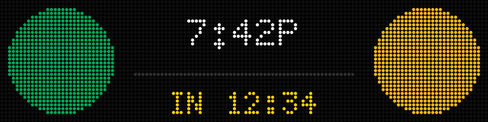

Start time, a rule, and the countdown (`IN 1H 29M`, then `IN 12:34` under an hour, ticking
down to `IN 00:59`). Same slot as `preview`:
`countdown_preview` switches between them on `countdown_hours`, so it's not a
choice.

### `matchup`: the season series

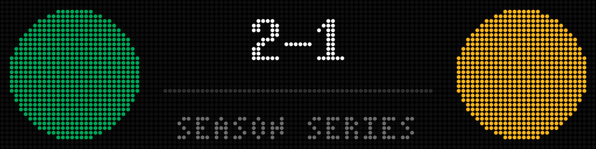

The favourite's head-to-head wins this season against the upcoming
opponent, drawn away-home like the game scene. `0-0` is a real answer and
shows. Fetched per upcoming game on an hourly cache, never live-polled.

- **Controls:** opt-in: `{screen = "matchup", seconds = N}` in `[[rotation]]`.
  Skipped with no upcoming game, before the first fetch lands, or if the API
  had no usable tally.

### `matchup_meetings`: the games behind the tally

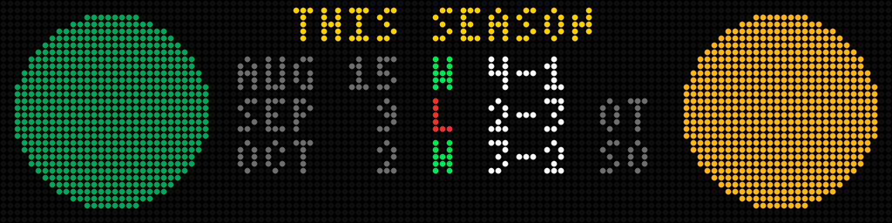

One row per finished meeting, from the favourite's side, oldest first:
`OCT 14 W 4-1`, with `OT`/`SO` after an overtime or shootout result. On a
single 64px panel the date, then the suffix, are dropped. It shares the
matchup entry's slot: the second half of its time goes to the meetings, and
the tally keeps the whole slot until a meeting has finished.

## Between games

These make up the idle rotation, and the table screens are the favourite's
unless noted.

### `standings`: the playoff picture

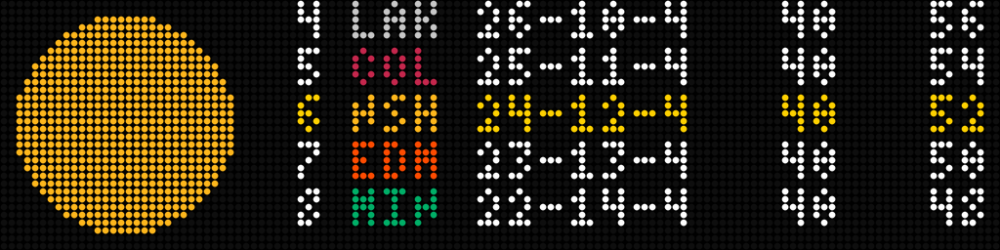

The favourite's conference: the favourite plus up to two teams either side,
by conference rank, clamped at either end so a team in 1st or last still
gets a full window. One screen, no paging. The favourite is highlighted.
Suppressed until the favourite has played a game, because the API keeps
serving last season's final table all summer. Hourly refresh.

- **Controls:** in the default rotation if `show_standings` is on; with an
  explicit `[[rotation]]`, it is there only if listed.
- A rule marks the real playoff cut once some team in the table has played
  41 games; before that the order is noise and the line misleads.
- The window is a straight conference-rank cut, not the NHL's actual playoff
  line, which the rule above does draw correctly.

### `conference_leaders`: the whole conference

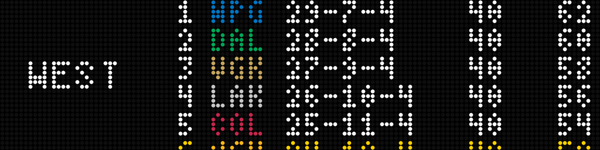

Every team of one conference by rank, with `WEST` or `EAST` where the logo
would be, the favourite highlighted. The table scrolls: it rests two seconds
at the top, scrolls evenly, rests at the bottom. A longer dwell scrolls
slower, never faster than five pixels a second, so the entry's seconds are a
*minimum*: the slot stretches (about 17s for 16 teams) when that is too short
to read. Rows partly off the panel are clipped, as on hardware.

- **Controls:** opt-in: `top_west` and `top_east` in `[[rotation]]`. Not
  gated on games played.

### `division`: the favourite's division

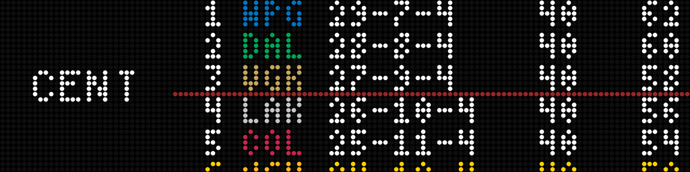

The same table for the favourite's own division, ranked within it, with its
name (`ATL`, `METRO`, `CENT`, `PAC`) in the label block. Scrolls like the
conference screen. Opt-in (`division`); hidden until the favourite has played.

### `wildcard`: the wild-card race

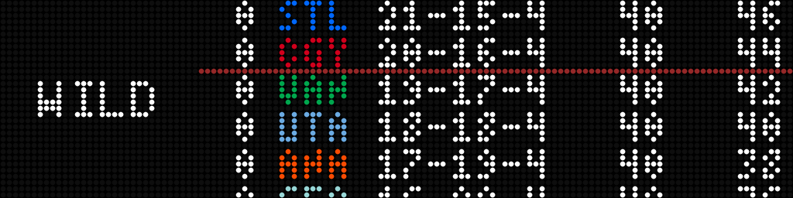

Teams outside the top three of a division, by wild-card position, with
`WILD` in the label block and a red rule after 2nd. Opt-in (`wildcard`);
hidden until the favourite has played.

### `leaders`: the favourite's top players

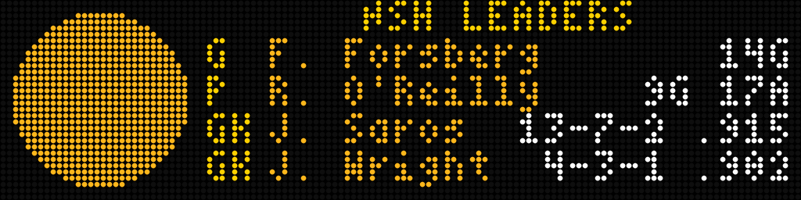

The favourite's logo, a title (`NSH LEADERS`) and up to four rows: top goal scorer, top
point getter, and the two goalies with the most games played (record and
save %). Ties, including everyone at zero early in the season, are broken at
random once per hourly fetch so the pick holds rather than flickering.
Skipped only while the API returns no players at all (pre-season).

- **Controls:** opt-in: `leaders` in `[[rotation]]`.

### `clock`: the idle clock

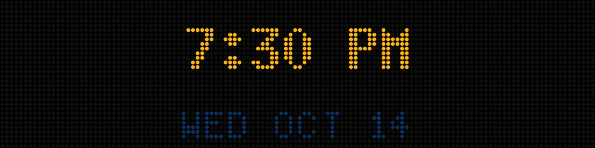

Time and date. Shown between the favourite's games if `show_clock_between_games`
is on (or as a `clock` rotation entry), or when there is nothing else to show
and `show_clock_when_idle` is on. Holidays decorate it (below).

### `christmas_tree`: December countdown

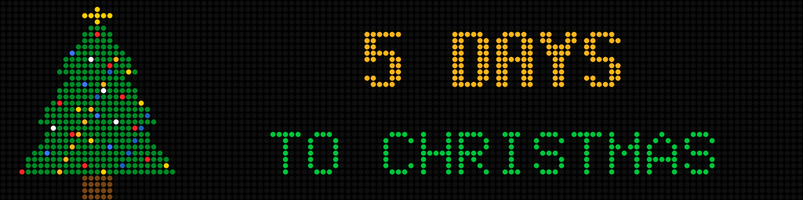

A twinkling tree in the favourite's colours beside a countdown to the 25th
(`MERRY CHRISTMAS` on the day), or just the tree when the countdown doesn't
fit on a single 64px panel. Dec 1-25.

- **Controls:** opt-in: `holiday` in `[[rotation]]`, and Christmas must be
  ticked under `[holiday]`. Skipped otherwise.

## Setup and status screens

### `address`: where the admin page is

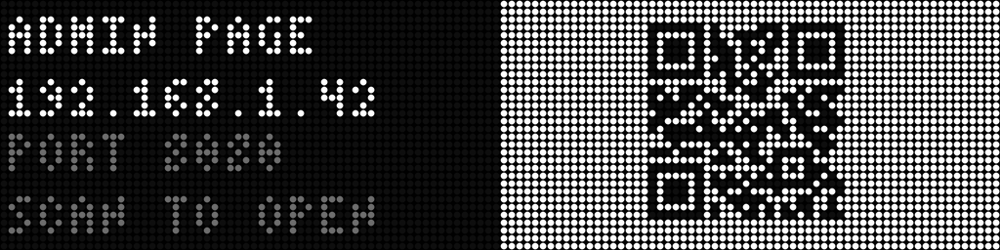

`ADMIN PAGE`, the board's IP (and `PORT 8080` when it isn't 80) on the left half, a QR code
to the full URL on the right; a single 64px panel shows the QR alone. Shown
by itself for 60s the first time the board gets a network connection, after
the setup and join screens below, and any time as the opt-in `address`
rotation entry. Skipped with no network or the admin page off.

### `ap_setup`: first-boot Wi-Fi

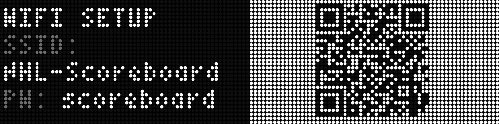

`WIFI SETUP` with the setup network's name and password on the left, a QR
code that joins it on the right. Shown whenever the board has no network and
is broadcasting its own setup network, where a phone can pick the real
Wi-Fi from a captive-portal page. It also shows when that page's display
check is in play, which is how someone with the wrong `hardware_mapping`
finds out. Takes priority over everything except `wifi_join`.

### `wifi_join`: the result of joining

| | | |
|---|---|---|
| 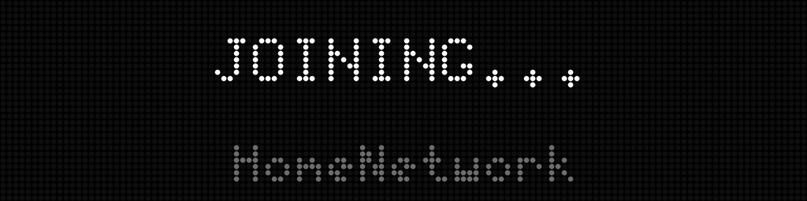 | 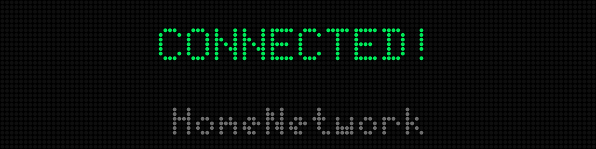 | 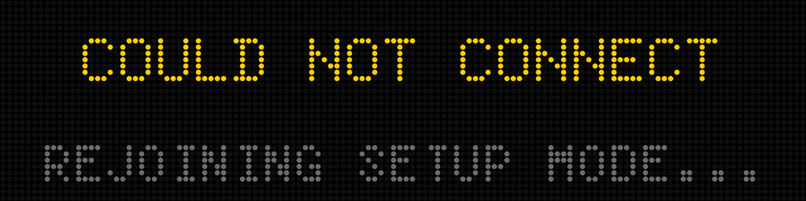 |
| `JOINING...` and the network's name. | `CONNECTED!` | `COULD NOT CONNECT`, then setup mode returns so the phone can retry. |

The panel is where the result shows, because joining tears down the very
network the phone's request arrived over. Top priority of every screen, for
15s after the outcome.

### `connecting`, `no_data`, `no_games`

| | | |
|---|---|---|
| 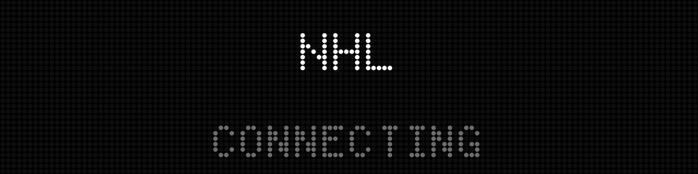 | 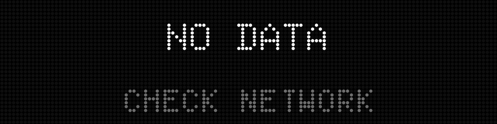 | 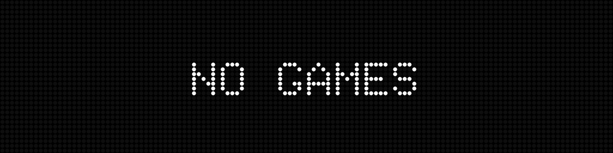 |
| `NHL CONNECTING`: before the first successful score fetch. | `NO DATA` / `CHECK NETWORK`: the last good poll is over 15 minutes old. | `NO GAMES`: nothing to show and the idle clock is off. |

## Holiday decorations

An overlay on top of whichever screen is up, not a screen of its own: no
scene knows holidays exist. Off by default; tick the holidays you want
under `[holiday]` or on the admin page's Holiday Cheer tab. Each runs in a
date window in the board's timezone.

- A **fly-by** sprite crosses the panel now and then (`flyby_frequency`:
  `rare` about 1 an hour, `occasional` about 3, `frequent` about 6), even
  during a game, but never over `goal`, `goal_detail`, `three_stars`,
  `ap_setup` or `wifi_join`.
- **Static decorations** (pumpkins, presents and so on) go only on `clock` and
  `no_games`: the logos fill both edges of every game, countdown and preview.
- Overlaps go to the higher priority (Canadian Thanksgiving over Halloween
  for its long weekend), then to calendar order.

| Holiday | Window | On a game | On the clock |
|---|---|---|---|
| Halloween | October | 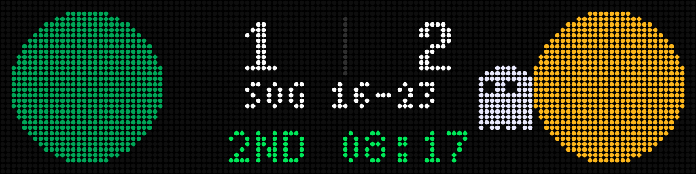 a ghost | 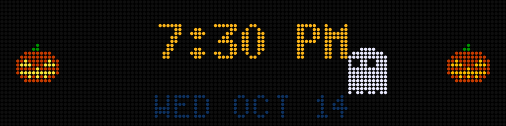 pumpkins |
| Thanksgiving | the week up to the 4th Thursday of November (US); Canadian, Fri to 2nd Monday of October, is off by default | 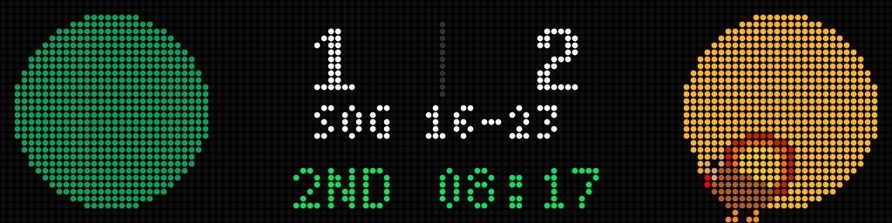 a turkey | 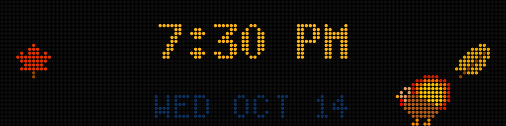 leaves |
| Christmas | Dec 1-26 | 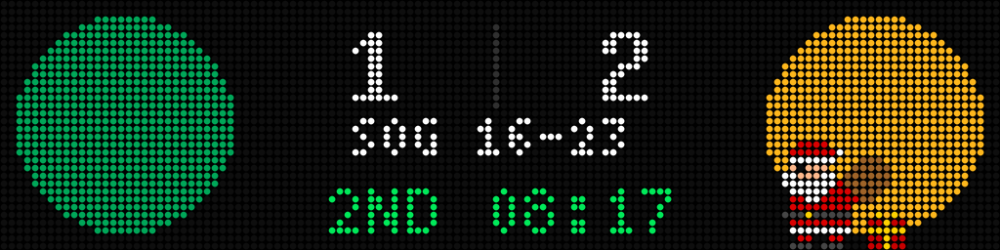 Santa, dropping presents | 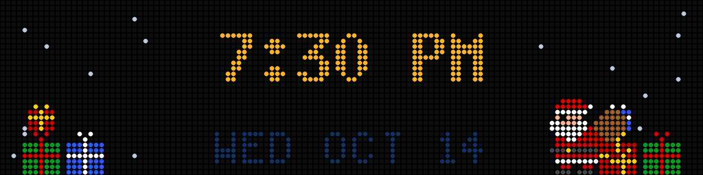 presents and snow |
| New Year's | Dec 31-Jan 1 | 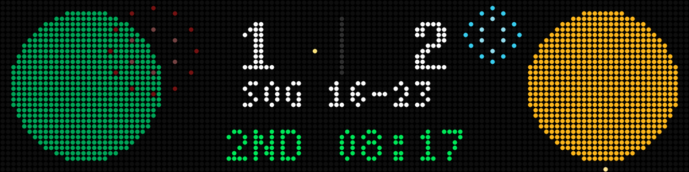 fireworks | 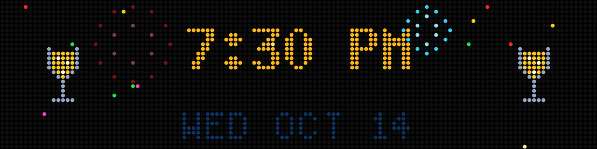 champagne, confetti |
| Groundhog Day | Feb 2 | 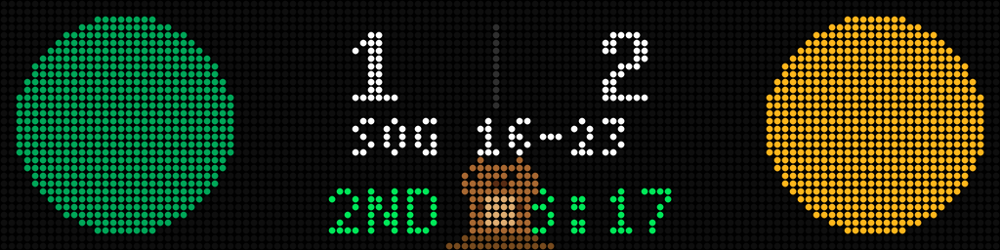 a groundhog, who may see his shadow | 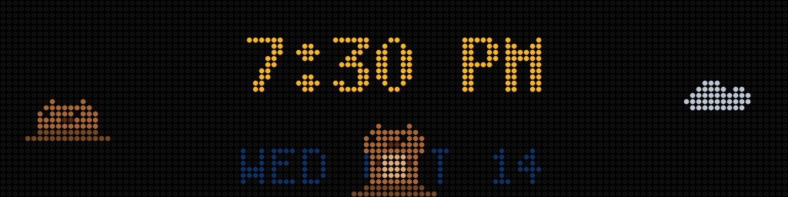 a sun (six more weeks) or a cloud |
| Valentine's | Feb 7-14 | 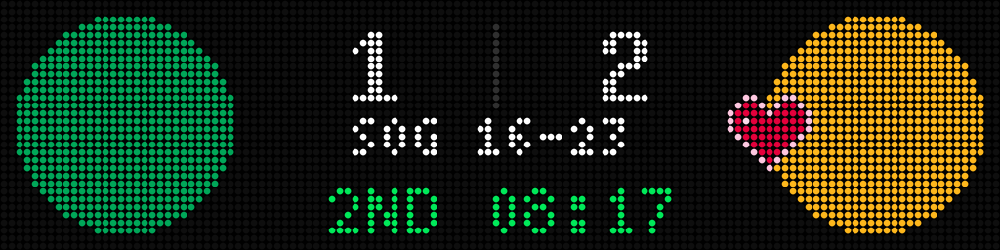 a beating heart | 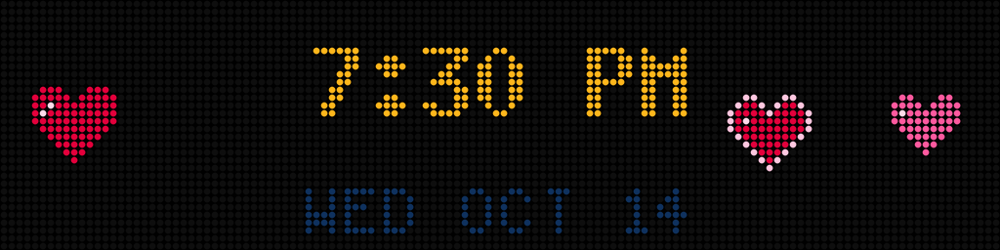 hearts |
| St. Patrick's | Mar 14-17 | 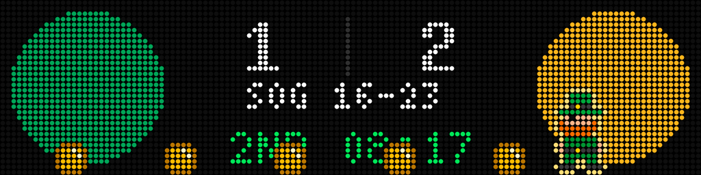 a leprechaun collecting coins | 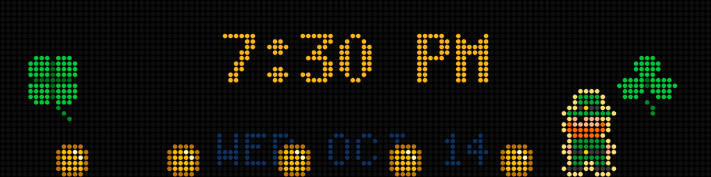 coins and shamrocks |
| Easter | the week up to Easter Sunday | 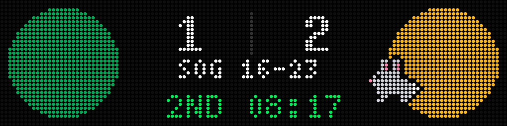 a hopping bunny |  eggs in team colours |
| Canada Day | Jul 1 (off by default) | |  fireworks and flags |
| July 4th | Jul 4 | |  fireworks and flags |

Canada Day and July 4th are shown on the clock because July is the
off-season. The Christmas tree screen above is separate and opt-in.

## Variants that apply to most screens

**Logo layout and text layout.** With `show_logos` on and logo art
available, the game, goal, goal detail, three stars, preview, countdown,
matchup, standings and leaders screens put a 32px logo at each edge. Without
logos they fall back to team abbreviations, and use the whole width:

| | |
|---|---|
|  |  |
|  |  |
|  |  |
|  |  |
|  | |

**A single 64×32 panel** (`chain_length = 1`). The screens are computed from
the panel's width, not hardcoded to 128. The two logos would otherwise meet
with no room for the score, so each logo's centre-facing edge is cropped to
half its width (never the panel-flush edge) and a 32px middle column is
kept; screens that don't fit (the countdown line, the address text) drop to
what does.

**Night mode** isn't a screen. Inside its window it dims the panel to
`dim_brightness`, unless a tracked game is live or ended recently, and at
`dim_brightness = 0` skips drawing entirely rather than relying on
brightness 0 being dark.

**April 1st** relabels Predators screens as another team, labels only; it is
left out of this guide on purpose.

## The admin page

Served by `admin_server.py` on `status.port` (8080 by default), the React
page in `frontend/` talking over one WebSocket. It has no login: it's meant
for the local network, so don't port-forward it. Four tabs:

- **Home:** the board status (current scene, game, last poll, last error), a
  switch for demo mode (loops every screen above with made-up data), the
  **Live view**, and the config cards: Scoreboard, Panel, Idle rotation,
  Status page, Night mode, Wi-Fi, Software update and Reboot / Shut down.
- **Audio:** the horn settings and custom horns, plus the wah-wah and
  followed-team ding.
- **Holiday Cheer:** which holidays are on, and how often the fly-by runs.
- **Logs:** the board's journal, streamed while the tab is open.


The **Live view** card draws a snapshot of the panel as round LED dots, taken
whenever the screen changes, so you can see what the board is showing
without looking at it. Snapshots, not a stream, so the board isn't recording
every frame for a page left open. Most cards save themselves as you edit, with
an Undo; Panel and Status keep a Save button because a wrong value there can
leave the panel dark or the page itself off.

| | |
|---|---|
|  |  |
| The Audio tab. | The Logs tab. |

The setup page that shows on a phone while `ap_setup` is up is a separate
page, `setup_server.py`: a display check (is the panel lit?), a list of nearby
networks plus a field to type one in, and a password box. It works without
internet by design.
