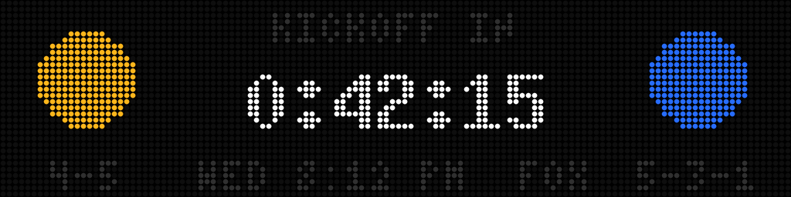
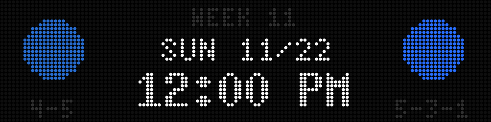
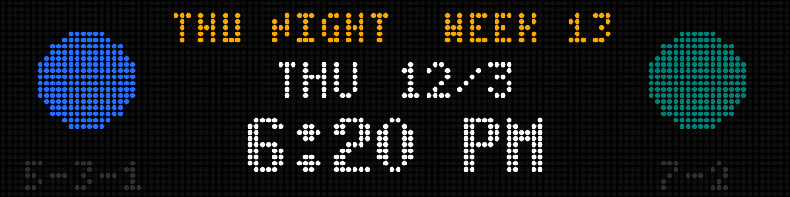
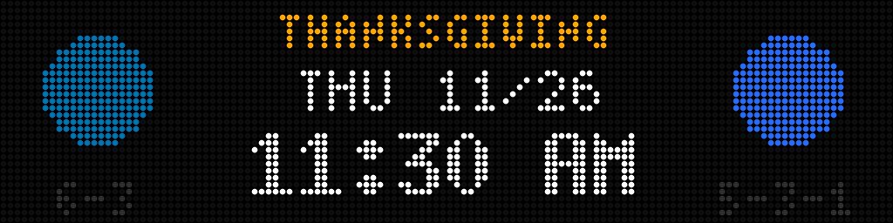
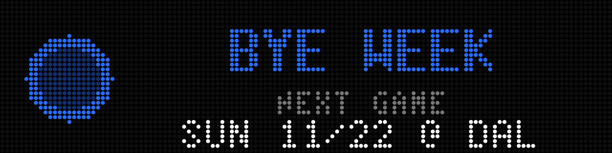
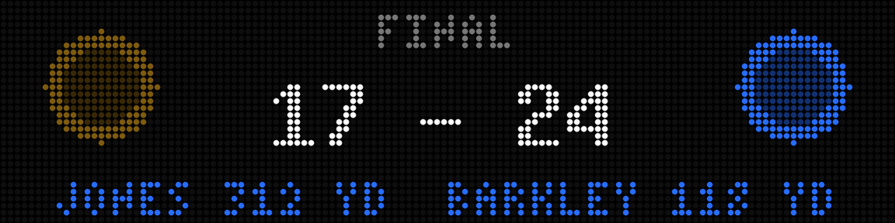
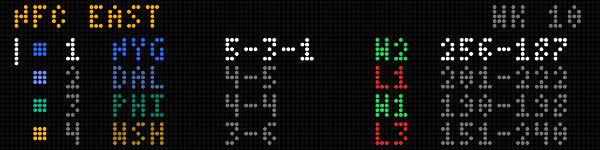
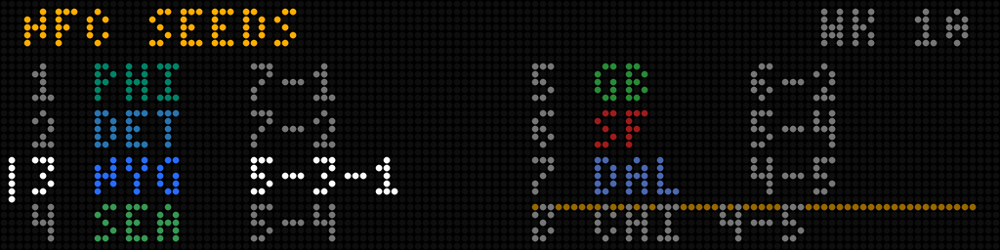
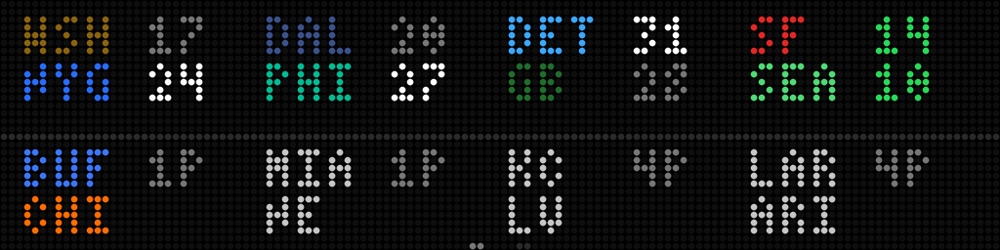
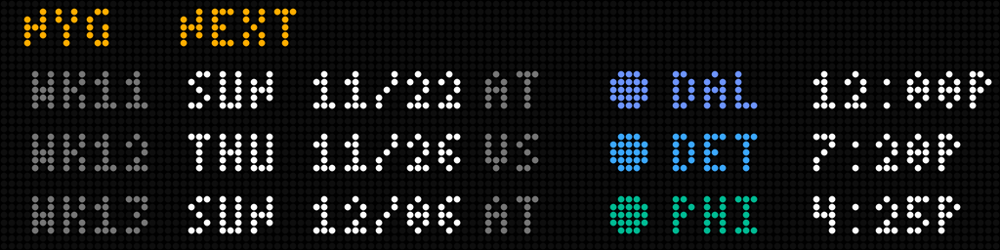

# Football (NFL) screens when no game is on: design and todo

What an NFL board shows **between games**: before kickoff, after the final whistle, on
and on a bye week. It is the NFL counterpart of the NHL
guide's "Before a game" and "Between games" sections in [`screens.md`](screens.md)
(`preview`, `countdown`, `standings`, the idle rotation, `clock`).

This file is a **proposal for the owner to edit**: nothing here is built or decided
unless it says so. The in-game screens (the field, every play, the celebrations) are
in [`football_screen.md`](football_screen.md); what ESPN's feed returns is in
[`football_api.md`](football_api.md). Read those two first. Open work for this file is
the todo at the bottom; update it in the PR that does the work.

An NFL season is 17 games in about 18 weeks, so a board is **idle most of the time**:
one live game on a Sunday (three hours), then six days of nothing. What it shows then
is most of what anyone sees of it. That is the reason for this file.

## What it shows today

Built in the base scenes (#352) and the in-game work (#377-#396). With no game live the
board falls back to these, and only these:

| Situation | What is shown today |
|---|---|
| Before the game | `fb_scores`: the matchup and the kickoff time (`SUN 11/15 12:00 PM`), blue |
| At the half | `fb_halftime` (#388) |
| Once final | `fb_scores`: the score and `FINAL`, grey, held until the slate moves on |
| Games today, none involve the favourite or followed teams | every game takes a turn, `rotate_seconds` each (`NflMode.pick_game`) |
| The feed answered and the slate is empty (a bye week) | `fb_no_games`: `NO GAMES` over `NFL` |
| The feed is stale or never answered | `fb_no_data` / `fb_connecting` |

So on a bye week or in March the board says `NO GAMES NFL` and nothing else, and the
idle clock, holidays and everything between games that the NHL board has are absent.
The scoreboard feed is asked for **today's slate only** (`scores(date=None)`), so the
board cannot say when the next game is. The research below (`football_api.md`, "Between
games") shows the feed already hands the board more than it uses: the week, a list of the
teams on a bye, and the whole season's calendar.

## Principles

- **Never a blank or a bare "NO GAMES" while there is something worth saying.** The NHL
  rule ("a screen with nothing to show right now is skipped, never shown blank") carries
  over.
- **The favourite comes first.** Everything below is about the favourite's team; with no
  favourite set it is about the league.
- **Football is a weekly sport.** The next game is days away, not hours: the useful
  numbers are days and the day and time of kickoff, not a puck-drop countdown.
- **Same machinery as the NHL idle rotation where it fits**: a list of screens, each for
  its own number of seconds, a screen with nothing to show skipped. Whether NFL mode reads
  the existing `[[rotation]]` setting or gets its own is an open question.
- **Cheap on the feed.** Anything that needs more than the live scoreboard (a schedule, a
  standings table) is fetched rarely (hourly or daily) and cached, never per frame.
- **Everything is optional and degrades.** If the data for a screen is missing it is
  skipped, and the board falls back to the clock or `fb_no_games`.

## Proposed screens

Each is a proposal with the data it needs. The endpoints were checked against the live feed
on 2026-11-13; the findings are in `football_api.md`, "Between games".

### `fb_countdown`: kickoff is close

The favourite's game starts within the hour (or the hours before, as `countdown_minutes`
does in NHL). Both teams' logos at the edges, `KICKOFF IN` and a countdown in the middle
(`0:42:15`), the broadcast time under it. Replaces `fb_scores` for that game once it is
inside the window. Data: the game's start time, already in the scoreboard feed.

### `fb_preview`: the next game, days away

The favourite's next game, up to a week out: `SUN 12:00 PM`, `@ WSH` or `vs DAL`, both
logos, the week number, optionally the records and the broadcast. The NFL equivalent of the
NHL `preview`, with days instead of hours. Data: the team **schedule** (`/teams/{id}/schedule`, 17 games, 300 KB, fetched daily) gives
the next game's date and opponent; **records** and the **broadcast** are on the scoreboard
events (`records`, `broadcasts`) once the game is in the week being polled.

### `fb_bye`: a bye week

When the favourite has no game this week: `BYE WEEK`, the logo, and the next game
(`NEXT: SUN 11/22 @ DAL`). Replaces `NO GAMES`. Data: **the scoreboard already says it**: `week.teamsOnBye` lists the
teams on a bye that week, so no schedule is needed to know; the next game is in the schedule
(`byeWeek` is also in it).

### `fb_final`: after the game

`fb_scores` already holds the final. Proposed: after the game the favourite's final stays
for a set time (the NHL's `final_hold_minutes`), then the rotation resumes. Optionally a
**recap** line (the winning team, the margin, the leading passer or rusher). Data: the
final score and, for the recap, the final event's `leaders` (the game's top passer and rusher, each tagged with its team: #420).

### `fb_standings`: the playoff picture

The favourite's **division** (four teams, W-L-T, the favourite highlighted) and, as a
second page, the **conference** seeds (1-7 with the cut line). The NFL counterpart of
`division`, `wildcard` and `standings`. Data: the **standings** endpoint (`/apis/v2/sports/football/nfl/standings`, `?level=3` for
divisions): each team's `overall` record, `playoffSeed`, `streak` and points for and against.

### `fb_week`: the league's slate

Everyone's score for the week on one frame, the way `scores` shows several NHL games: on a
Sunday, the other 15 games; on Monday, the whole week's finals. A grid of small score
cells, paged. Data: `scoreboard?week=N&seasontype=2` returns the **whole week's** games (16 for week 12), so
one request fills the grid; `week.teamsOnBye` names the teams missing from it.

### `fb_schedule`: the next few games

The favourite's next three games in a column: date, opponent, home or away. Data: the
schedule (`/teams/{id}/schedule`); a missing week number in it is the bye.

## Mockups

First drafts at 128x32 (these screens are skipped on a 64px panel), drawn in the same round-LED
style as `football_screen.md`'s by `python scripts/football-idle-mockups.py` into
[`docs/football-idle/`](docs/football-idle/). **Design mockups, not renderer output**: hand-drawn
with the project's fonts, plain colour circles for the crests, made-up numbers, the favourite
shown is NYG. The tiny 4x6 font has no `@` and no `#`, so away games read `AT`.

| | |
|---|---|
|  |  |
| `fb_countdown`: kickoff in the hour. Both logos and records (from the scoreboard), the countdown between them, the day, time and broadcast under it. | `fb_preview`: the next game, days away. The week, the day, the time, the records. |
|  |  |
| A primetime game: the tag (`THU NIGHT`) goes before the week. | A holiday game: the tag (`THANKSGIVING`) and, suggested here by the trim along the top, the existing holiday overlay in NFL colours. |
|  |  |
| `fb_bye`: the logo, `BYE WEEK` and the next game, from the schedule. | `fb_final`, held 60 minutes: the score, the loser's logo dimmed, and the recap (the leading passer and rusher) across the bottom. |
|  |  |
| `fb_standings`, page 1: the favourite's division (rank, record, streak, points for and against), the favourite in white. | Page 2: the conference's seven seeds and the cut line, with the first team out under it. |
|  |  |
| `fb_week`: eight games a page, away over home; finals with the winner bright, a live game in green, an upcoming one with its kickoff hour. Two pages for 16 games. | `fb_schedule`: the favourite's next three games, week, date, opponent, time. |

## Carry-over from the NHL idle rotation

The NHL side is in [`screens.md`](screens.md), "Between games". Proposed fate of each:

| NHL screen | In NFL mode |
|---|---|
| `clock` (`clock`, `show_clock_when_idle`) | **Carries over unchanged**: it is not sport-specific. The fallback when nothing else has anything to show. |
| `christmas_tree` and the holiday decorations | **Carry over unchanged**, with the one known gap in `CLAUDE.md`: the holiday overlay still uses NHL team colours with NFL abbreviations. |
| `address`, `ap_setup`, `wifi_join`, `connecting`, `no_data`, `no_games` | **Carry over** (`fb_connecting`, `fb_no_data` and `fb_no_games` already exist). |
| `preview`, `countdown` | Become `fb_preview`, `fb_countdown` above. |
| `standings`, `division`, `wildcard`, `conference_leaders` | Become `fb_standings` (a division page and a conference page). |
| `scores` (the all-games grid) | Becomes `fb_week`. |
| `matchup`, `matchup_meetings` (the NHL season series) | **Do not apply**: teams meet once or twice a year. Optionally a head-to-head line on `fb_preview`. |
| `leaders` (the favourite's top players) | Possible later as team leaders (passing, rushing); needs the roster stats endpoint. |
| `three_stars` | **Does not apply.** |

## Which screen is chosen (proposed)

Highest first; the first that has something to show wins, as in the NHL list in
`screens.md`:

1. The favourite's game live, or a followed team's live game (as today: `pick_game`).
2. The favourite's game is inside the kickoff window: `fb_countdown`.
3. The favourite's game just ended: `fb_final`, held for a set time.
4. **The idle rotation**: a list of screens, each for its own seconds (proposed default
   `fb_preview`, `fb_standings`, `fb_week`, `fb_schedule`, then the clock), a screen with
   nothing to show skipped.
5. The favourite is on a bye: `fb_bye` joins the rotation.
6. With no favourite set: every game of the week, as `pick_game` does today.
7. Otherwise the clock, else `fb_no_games`.

## Data needs and research

Checked against the live feed on 2026-11-13 and written up in `football_api.md`, "Between games"
(trimmed responses are in `tests/fixtures/football/`). The short version:

- **The week and the byes** are on the scoreboard the board already polls: `week.number`,
  `week.teamsOnBye` (full team objects) and, on every in-season response, the whole season's
  **calendar** with each week's dates. `fb_bye` and "week N" cost nothing extra.
- **The whole week's games** come from `scoreboard?week=N&seasontype=2` (one request): `fb_week`.
  A date **range is a 400**; `dates=YYYY` returns a calendar year's games.
- **The schedule** is per team (`/teams/{id}/schedule`, ~300 KB, regular season only, the bye as
  a missing week): `fb_preview`, `fb_schedule`, the next game on `fb_bye`. Fetch it daily.
- **Standings** are on `/apis/v2/...` (not `/apis/site/v2/`), ~158 KB: the two conferences by
  default, the four divisions each with `?level=3`. Each entry has `overall`, `playoffSeed`,
  `streak` and points for and against. Fetch hourly at most.
- **The postseason** is `seasontype=3`: until the bracket is set its games read `TBD @ TBD`.
- **The recap's leaders** (checked in #420): each *final* event has the game's top passer, rusher and
  receiver (one each, across both teams, with the team id, `shortName`, jersey and a ready
  `displayValue`). A scheduled game's `leaders` are **season totals**, so read them only from a final.
- **The calendar names the postseason rounds** (`Wild Card`, `Div Rd`, `Conf Champ`, `Super Bowl`) and the
  off-season; postseason games read `TBD @ TBD` until set; an empty January day is a gap in a round,
  not the end of the season.
- **Not yet checked:** a game in progress's leaders (no game was live), and the real bracket once set.

## Built: the data layer (#421)

`football/idle.py` parses and caches what these screens read; nothing draws yet. `NflClient` gained
`scoreboard()` (the games **and** the week, the teams on a bye and the season calendar; `scores()` is
now its games), `week(number, season_type)` (a whole week in one request), `schedule(team_id)` and
`standings()` (on the `/apis/v2/` base, `?level=3`). The feed worker publishes an immutable
`IdleSnapshot` on `FeedSnapshot.idle`; the render loop only reads it.

- **Cadences:** a team's schedule **daily**, the standings **hourly**, the week's games every
  **5 minutes**; each only when due. The schedule is fetched for the favourite and the followed teams
  (NFL teams only), the standings only when someone is followed, the week whenever the board is idle.
- **Nothing is fetched while any game is live**; the last data is kept, and the week, byes and calendar
  from the poll the worker makes anyway still update.
- **A failed fetch keeps the last good data** and is retried after 60 seconds, not every frame; data older
  than **twice its window is stale** and the snapshot's accessors (`schedule(team_id, now)`,
  `standings(now)`, `week(now)`) return `None` rather than present it as fresh.
- `FbGame` now carries `season_type`, `broadcasts` and, **for a final only**, `leaders` (a scheduled game's
  `leaders` are season totals: #420). A team's `TeamSchedule` has `next_game(now)` and `upcoming(now)`; the
  standings have `division_of`, `conference_of`, and per conference `seeds()` and `unseeded()`.

## Decisions (owner, 2026-11-13)

- [x] **Its own rotation.** NFL mode has its own idle rotation under `[football]` (NFL screen names),
      not the shared `[[rotation]]`, so switching sport never shows screens that do not exist. The
      admin page gets an NFL version of the Idle rotation card.
- [x] **The final is held 60 minutes, with a recap line.** A setting (default 60 minutes, like the
      NHL's `final_hold_minutes`); the final screen adds a **recap**: the leading passer and rusher
      (the per-event `leaders`: see #420 in `football_api.md`).
- [x] **Preseason and playoffs are games.** All three seasons get the same screens. The round is
      labelled: `PRESEASON WK 2`, `WILD CARD`, `DIVISIONAL`, `CONF CHAMP`, `SUPER BOWL`. A `TBD @ TBD`
      playoff game is skipped until its teams are known.
- [x] **Records on the preview and the countdown**, read from the scoreboard events' `records`
      (`overall`) when the game is in the polled week; omitted when it is not. No extra request.
- [x] **No off-season screens.** The board is not in football mode in the off-season, so there is
      no `fb_offseason`, no draft or training-camp dates and no setting for them.
- [x] **128px only.** These screens are skipped on a single 64px panel (it shows the clock, or
      `fb_no_games`). The in-game screens keep their 64px layouts.
- [x] **Primetime and holiday games** get a tag on the preview (`THU NIGHT`, `MON NIGHT`,
      `THANKSGIVING`, `CHRISTMAS`, from the feed's broadcast and date) **and the existing holiday
      overlay** on Thanksgiving and Christmas games.
- [x] **Holiday decorations on Thanksgiving and Christmas games only**, using the existing holiday
      overlays, drawn in the playing teams' **NFL** colours (the overlay still uses the NHL colour
      table with NFL abbreviations, a known gap in `CLAUDE.md`, to be fixed as part of this). No other
      holiday touches a game screen.
- [x] **The default NFL idle rotation:** `fb_preview` 8s, `fb_standings` 8s (the division, then the
      conference), `fb_week` 10s, `fb_schedule` 8s, then the clock 6s. A screen with nothing to show is
      skipped. `fb_bye` joins the loop on a bye week and `fb_final` holds for its 60 minutes after a
      game. All are settings under `[football]` and the admin page's NFL rotation card.

## Open questions

None left. The next step is the build, one story each (see the todo).

## Todo

### Research
- [x] Verify the schedule, standings and week-view endpoints; added to `football_api.md`.
- [x] Capture the bye-week responses (fixtures in `tests/fixtures/football/`).
- [x] Check the per-event `leaders` for a recap line, and the playoff gaps (#420; see above).

### Design
- [x] Decide the main open questions (above); the three left are small.
- [x] First-draft mockups for each screen (128px only), `scripts/football-idle-mockups.py`; the owner's review is next. The real ones to be made the way
      `football_screen.md`'s are (`scripts/render-screens.py --sport nfl` once built).
- [x] The default idle rotation and its settings; the admin page's rotation card for NFL mode (#422).

### Build (after the design is agreed, one story each)
- [x] The schedule, standings and week fetch and cache (#421, `football/idle.py`).
- [x] `fb_countdown` (#423, `display/football_idle.py`; the real render is `docs/football/fb_countdown.png`)
- [x] `fb_preview` (#424: `football/idle_views.py` builds it, the tag and round rules are pure functions; a
      tag too long to sit beside the week, `THANKSGIVING`, drops the week)
- [ ] `fb_bye`
- [ ] `fb_final` (the hold, and the recap if kept)
- [ ] `fb_standings`, `fb_week`, `fb_schedule`
- [x] The NFL idle rotation and the scene selection above, with the clock as the fallback (#422;
      `NflMode._idle_kind`, the registry in `football/idle_screens.py`).
- [ ] Demo steps and `scripts/render-screens.py --sport nfl` images for each
